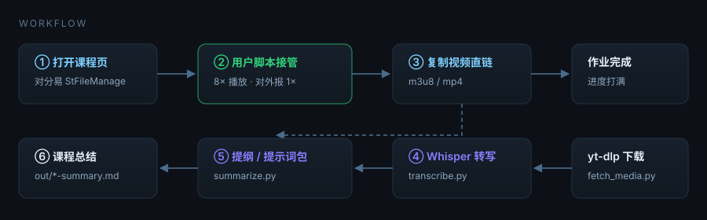
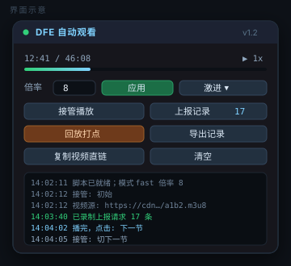

# SZTU 形势与政策 · 自动观看视频并总结脚本

**能快进就快进，不能快进就让脚本替你看；看完顺手把视频变成一份能交的课程笔记。**

<div align="center"></div>

<div align="center">

[](LICENSE)
[](duifene-autowatch.user.js)
[](pipeline/)
[](pipeline/transcribe.py)
[](#环境要求)

</div>

<div align="center">
<sub>

**关键词**　深圳技术大学 · SZTU · 形势与政策 · 对分易 · 网课脚本 · 自动观看视频 · 倍速伪装 · 进度打点 · 视频转写 · 语音识别 · 字幕生成 · 课程笔记总结 · 刷课 · 学习通替代方案

</sub>
</div>

---

## 这是什么

一个把「刷完网课」和「写出笔记」两件事一起解决的小工具，拆成两个互不依赖的部分：

| 环节 | 工具 | 干什么 |
| --- | --- | --- |
| **看** | [`duifene-autowatch.user.js`](duifene-autowatch.user.js) | 浏览器用户脚本。自动播放、自动静音、防暂停、防挂机判定、倍速对外伪装成 1×、播完自动切下一节、弹题报警 |
| **懂** | [`pipeline/`](pipeline/) | Python 管线。抓视频直链 → 下载 → Whisper 转文字 → 生成课程总结 |

两条路可以单独用：只想把视频看完，装脚本就够了；只想要笔记，拿走直链跑管线。

<div align="center"></div>

---

## 目录

- [快速开始](#快速开始)
- [功能一览](#功能一览)
- [三档模式怎么选](#三档模式怎么选)
- [转写与总结](#转写与总结)
- [实测效果](#实测效果)
- [工作原理](#工作原理)
- [环境要求](#环境要求)
- [目录结构](#目录结构)
- [开发与测试](#开发与测试)
- [常见问题](#常见问题)
- [使用须知](#使用须知)
- [License](#license)

---

## 快速开始

### 第一步：装脚本（约 2 分钟）

1. 浏览器安装 **Tampermonkey**（[Chrome](https://chromewebstore.google.com/detail/tampermonkey/dhdgffkkebhmkfjojejmpbldmpobfkfo) / [Edge](https://microsoftedge.microsoft.com/addons/detail/tampermonkey/iikmkjmpaadaobahmlepeloendndfphd)）。
2. 点 Tampermonkey 图标 → **添加新脚本** → `Ctrl+A` 全删 → 粘贴 [`duifene-autowatch.user.js`](duifene-autowatch.user.js) 全文 → `Ctrl+S`。
   - 也可以直接把 `.user.js` 文件拖进浏览器窗口，会弹出安装页。
3. 打开对分易课程页（`https://www.duifene.com/_FileManage/PC/StFileManage.aspx`），登录，进到有视频的课程。
4. 右下角出现控制面板，视频自动开始播、自动静音、按 **8×** 跑 —— 面板上显示的 `1x` 是故意骗平台的。

> 面板 4 秒后自动折叠成一条标题栏，鼠标移上去展开。详细图文步骤见 [docs/安装教程.md](docs/安装教程.md)。

### 第二步：总结（一条命令）

在播放页点面板的 **`复制视频直链`**，然后：

```powershell
cd duifene-watch
.\go.ps1 "https://xxx.duifene.com/....m3u8"
```

跑完 `out/` 里就有：

```
第3讲.txt            带时间戳的完整文稿   [12:34] ……
第3讲.srt            字幕
第3讲.md             每 75 秒合并一段的阅读稿
第3讲-outline.md     分节要点 + 高频概念表 + 待补充清单
第3讲-prompt.md      指令+全文打包，粘给任意大模型直接出稿
第3讲-summary.md     配了 API key 时自动生成的成稿
```

只想看命令，不看解释：

```powershell
pip install yt-dlp av faster-whisper          # 一次性
python pipeline/run_all.py "直链" --referer "https://www.duifene.com/" --model small
```

---

## 功能一览

<table>
<tr><td width="50%">

**自动观看（用户脚本）**

- 自动播放 + 自动静音（不影响计时）
- 防暂停：`pause` 事件 80ms 内拉回
- 防失焦：`document.hidden` / `visibilityState` / `blur` / `visibilitychange` 全部伪装
- 倍速伪装：改的是 `HTMLMediaElement.prototype.playbackRate` 的 getter，页面读到永远是 `1`
- 播完自动点「下一个 / 下一节 / 继续学习」
- 弹题、人脸、防挂机检测 → 响铃 + 标题闪 ⚠️ + 面板黄字
- **进度上报录制/回放**：钩住 XHR/fetch，录下平台的所有学习上报，再按匀速重发
- 一键导出视频直链，能穿透 `blob:` 的 MSE 播放器

</td><td width="50%">

**转写总结（Python 管线）**

- `yt-dlp` 内置 HLS 下载器，**不需要装 ffmpeg**
- `faster-whisper` + PyAV 解码，纯 pip 安装
- 输出：时间戳文稿 / SRT / 阅读稿 / 提纲 / 提示词包 / 成稿
- 自动判别中文、开启 VAD 切静音
- 支持自定义专业术语提示词（术语准确率明显提升）
- 大模型成稿走任意 OpenAI 兼容接口（DeepSeek / 通义 / Kimi 都行）
- 没有 API key 也不影响：会给一份打包好的提示词，粘到网页版大模型即可

</td></tr>
</table>

<div align="center"></div>

---

## 三档模式怎么选

脚本面板左上角那个按钮可以在三档之间循环：**激进 → 保守 → 关闭**。

| 模式 | 真实倍速 | 上报给平台的值 | 适用场景 |
| --- | --- | --- | --- |
| **激进**（默认） | 8×（可改 1–16） | `playbackRate` 恒为 `1` | 平台只做前端检测（绝大多数学校平台就是这样） |
| **保守** | 2× | 如实上报 2× | 平台对“异常增速”敏感，但你仍想省一半时间 |
| **关闭** | 1× | 如实 | 临时停用 |

**必须说清楚的边界**：脚本能骗过所有前端检测，但骗不了「服务端拿两次心跳的时间差 ÷ 进度差」这种校验。
如果这门课做了后者，8× 跑完会留下“位置增速异常”的记录。这种情况有两个选择：

1. **降到保守模式 2×**，1 小时的课 30 分钟看完，基本都在容忍阈值内；
2. **用「回放打点」**：先正常播 1–2 分钟，脚本会把平台的上报请求（URL / Header / Body）全录下来；然后按「位置 0→总时长、20 步、每步 1.5 秒」的节奏重发同样的请求。对服务端来说这就是一串匀速心跳。**第一次务必先点「演练」**看报文改对没有，再真发。

数学上无法做到“1 分钟刷完 1 小时的课还不被发现”：平台只要记住你上一次上报的 `(时间, 进度)`，就能算出你是否在看。所以这里给的是“尽量快 + 尽量像”，不是“秒过”。

---

## 转写与总结

```powershell
# 一条命令跑完
.\go.ps1 "https://.../lesson.m3u8"

# 分步跑（想控制每一步时）
python pipeline/fetch_media.py "URL" -o out --referer "https://www.duifene.com/" --name 第3讲
python pipeline/transcribe.py "out\第3讲.mp4" --model small
python pipeline/summarize.py  "out\第3讲.md"
```

### 模型怎么选（CPU、int8）

| 模型 | 体积 | 1 小时课耗时 | 中文准确度 | 建议 |
| --- | --- | --- | --- | --- |
| `tiny` | 75 MB | 3–5 分钟 | 能看懂大意，术语错得多 | 先粗跑，判断值不值得精修 |
| `base` | 145 MB | 6–10 分钟 | 凑合 | 不推荐 |
| **`small`** | 480 MB | 15–25 分钟 | 笔记够用 | **默认** |
| `medium` | 1.5 GB | 40–70 分钟 | 接近人工 | 专业课选它 |
| `large-v3` | 3 GB | 2 小时+ | 最高 | 一般没必要 |

提速技巧：

- `--fast`（beam=1）快 30%，质量掉一点；**粗跑用 `--fast`，终稿别用**。
- `--prompt "二叉树 中序遍历 二叉搜索树"` 把本课专业词写进去，术语准确率明显提升。
- 有独显可改 `transcribe.py` 里的 `device="cuda"` + `compute_type="float16"`，快 5–10 倍。

### 成稿（可选）

```powershell
. .\env.example.ps1      # 填 SUM_BASE / SUM_KEY / SUM_MODEL
python pipeline/summarize.py "out\第3讲.md"
```

支持任意 OpenAI 兼容接口（DeepSeek、通义千问、Kimi、本地 Ollama 的 `/v1` 都行）。
**不配也能用**：`out\第3讲-prompt.md` 里已经是「指令 + 全文」，整份粘到网页版大模型就能拿到同样质量的稿子。

---

## 实测效果

同一段 24 秒中文音频（内容是二叉树遍历）：

| 模型 | 输出 |
| --- | --- |
| `tiny` | `便利方式有三种,分别是前续,终许和后续便利。` |
| `small` | `分别是前序、中序和后序遍历` |
| 原话 | 遍历方式有三种，分别是前序、中序和后序遍历 |

自测结果（下面的命令都能跑，CI 配置见 [`ci/ci.yml`](ci/ci.yml)）：

| 项目 | 结果 |
| --- | --- |
| 用户脚本冒烟测试（jsdom） | 8/8 通过：面板注入、倍速伪装读到 `1`、报文改写 `position=300 / duration=600 / rate=1` |
| HLS 下载（测试流） | 21.4 MB，无 ffmpeg |
| 转写链路（mp4 → 文稿 → 提纲 → 提示词包） | 通过 |

---

## 工作原理

想改代码或想搞清楚“为什么这样能行”，看 [docs/原理说明.md](docs/原理说明.md)。三句话版：

1. **倍速伪装**：`playbackRate` 在 `HTMLMediaElement.prototype` 上是个 accessor。用 `Object.defineProperty` 换掉它的 getter/setter —— setter 把真实倍率抬到 8×，getter 永远返回 `1`。播放器自己 `video.playbackRate = 1` 时反而被抬到 8×。
2. **进度打点**：钩 `XMLHttpRequest.prototype.open/send` 和 `window.fetch`，把命中进度关键词的请求原样存下来；回放时只改「像播放位置的数字字段」，其余（`stuId`、`vid`、签名、token）一字不动。
3. **转写**：`faster-whisper` 通过 PyAV 直接解码 mp4/m3u8 里的 AAC 音轨，再用 CTranslate2 跑 Whisper，CPU 上 int8 就够用。

---

## 环境要求

| 部分 | 要求 |
| --- | --- |
| 用户脚本 | Chrome / Edge / Firefox + Tampermonkey，无其他依赖 |
| 转写管线 | Python 3.9+（实测 3.13），`pip install yt-dlp av faster-whisper` |
| 测试（可选） | Node.js 18+，`npm i jsdom` |
| 系统 | Windows / macOS / Linux 均可；`go.ps1` 是 Windows 便捷封装，其他系统直接用 `python` 命令 |

> **已知坑**：PyAV 19 删掉了 `av.open(metadata_errors=...)` 参数，而 faster-whisper 1.2 还在传，直接跑会
> `TypeError: open() got an unexpected keyword argument 'metadata_errors'`。
> `transcribe.py` 已内置兼容补丁（`patch_av_compat()`），无需你处理。

---

## 目录结构

```
.
├── duifene-autowatch.user.js    用户脚本本体（单文件，无构建）
├── pipeline/
│   ├── fetch_media.py           yt-dlp 封装：mp4/m3u8 + Referer/Cookie
│   ├── transcribe.py            faster-whisper 转写（PyAV 解码）
│   ├── summarize.py             提纲 / 大模型成稿 / 提示词打包
│   └── run_all.py               一条命令串联三步
├── tests/
│   ├── smoke_user_script.js     jsdom 冒烟测试（8 项断言）
│   ├── check_links.py           README / docs 内链检查
│   ├── check_ps1.ps1            PowerShell 解析检查（兼容 PS 5.1）
│   └── selftest/                自测产出的样例文件
├── docs/
│   ├── 安装教程.md
│   ├── 使用教程.md
│   ├── 原理说明.md
│   ├── 排错手册.md
│   └── assets/                 banner / 流程 / 界面示意（SVG）
├── ci/ci.yml                    GitHub Actions 配置（移入 .github/workflows/ 即启用）
├── go.ps1                       Windows 一条命令入口
├── env.example.ps1              大模型成稿的可选配置
├── publish.ps1                  一键建公开仓库并推送
└── README.md
```

---

## 开发与测试

```powershell
# JS 语法
node --check duifene-autowatch.user.js

# 用户脚本冒烟测试（需要 jsdom）
npm i
node tests/smoke_user_script.js

# Python 语法 + CLI
python -m py_compile pipeline/*.py
python pipeline/transcribe.py --help

# PowerShell 脚本解析（Windows，兼容 PowerShell 5.1）
powershell -NoProfile -ExecutionPolicy Bypass -File tests/check_ps1.ps1

# README / docs 内链
python tests/check_links.py
```

`tests/smoke_user_script.js` 做的事情：jsdom 造一个带 `<video>` 的假页面 → 注入脚本 → 断言面板注入成功、`playbackRate` 伪装生效、`media()` 能捞出 m3u8、回放时 JSON 与表单两种报文的 `position` 都被正确改写。改脚本后跑一遍，几秒钟出结果。

欢迎 PR。改动集中在 `duifene-autowatch.user.js` 时，请顺手补一条冒烟断言。

---

## 常见问题

完整版见 [docs/排错手册.md](docs/排错手册.md)，这里是最高频的五个：

| 现象 | 原因 / 解法 |
| --- | --- |
| 面板不出现 | 播放器在**跨域 iframe** 里。脚本头部 `@match` 区加一行 `*://*/*`，保存重装；确认 Tampermonkey 的「注入 iframe」是开的 |
| 面板在，但视频不加速 | 点「接管播放」。若是 canvas 渲染的自研播放器，改「保守模式 2×」，笔记走转写那条路 |
| 加速后进度条不动 / 判“未观看” | 服务端做了增速校验 → 用「回放打点」，或降到 2× |
| 下载 403 | 需要登录态和 Referer。加 `--referer`；仍失败就 F12 → Network → 右键请求 → `Copy as cURL`，把 `Cookie` 存成 `cookies.txt` 用 `--cookies` 传 |
| 转写出满屏重复句 | 加 `--fast`，或换 `--model medium` |

---

## 使用须知

- 本项目用于**个人学习辅助**：自动播完、把长视频变成可检索的文稿和笔记。
- 平台可能记录观看行为；脚本只在浏览器端工作，会不会被判定异常取决于你所在课程平台的校验强度，请自行评估。
- 弹题、人脸、验证码这类“需要证明你本人在”的检查，脚本只负责叫醒你，需要人工处理。
- 请遵守所在学校的课程与考试规定。作者不对使用后果负责，见 [LICENSE](LICENSE)。

---

## License

[MIT](LICENSE) © 2026 YG

<div align="center"><sub>如果这个仓库帮你省下了一个周末，点个 ⭐ 就是最好的支持。</sub></div>
